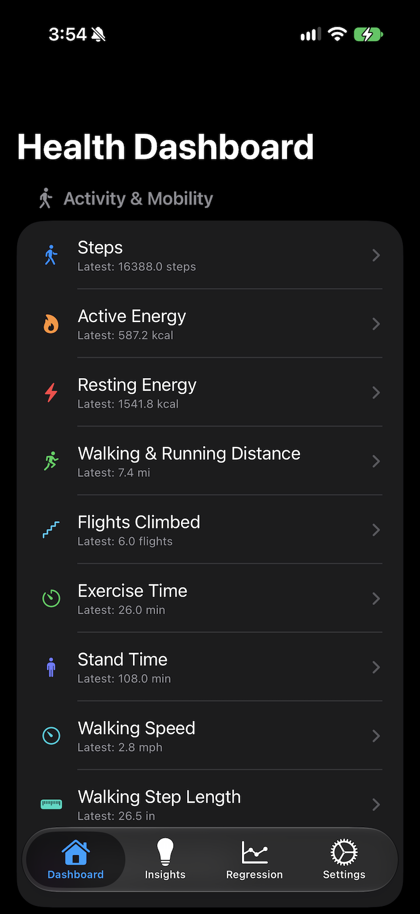
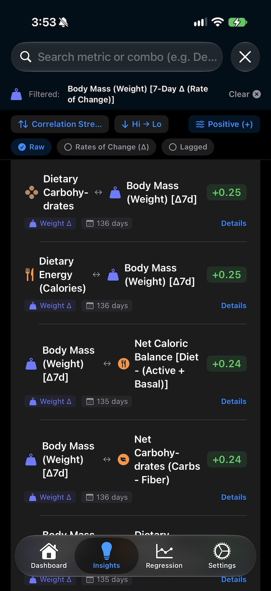
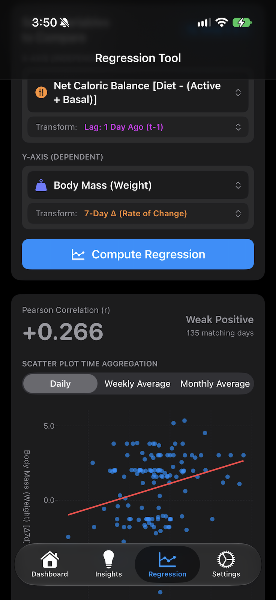

# Progress: Apple Health Insights

Progress is an iOS app that uncovers hidden connections in your Apple Health data. It tracks 25+ metrics, computes daily rates of change and time lags, and automatically surfaces statistically significant correlations between your habits and biological markers.

---

### Key Features

* **25+ HealthKit Metrics:** Physical activity, nutrition, vitals, body measurements, sleep, and mindfulness.
* **Smart Time-Series Engine:** Computes multi-day rates of change (1-day, 7-day, 14-day, and 21-day velocity) and time lags (e.g. yesterday's sleep vs. today's resting heart rate) with linear interpolation between sparse records.
* **Automated Insights Engine:** 
  * Scans feature combinations to surface and rank meaningful correlations while automatically filtering out trivial or collinear pairs (like Steps vs. Distance).
  * Instant search suggestions for common targets (Body Mass, Caloric Deficit, Sleep, HRV, Steps, Resting HR).
* **Interactive Exploration & Regression:**
  * **Unified Dashboard:** Clean metric trends with adaptive line, bar, and area charts. Average reference lines on weekly/monthly summaries consistently report daily figures.
  * **One-Tap Metric Comparison:** Jump directly from any metric dashboard into a full regression analysis with a chosen partner series.
  * **Custom Regression Tool:** Compare any two metrics or transformed features on demand with scatter plots, linear regression best-fit lines, and dynamic axis scaling.
  * **Search & Filter:** Filter discoveries by metric, polarity (+/-), or feature type (Raw, Rates of Change, Lagged).
* **Local & Private:** Runs entirely on-device with zero server uploads and caches discoveries locally.

---

### Tech Stack

* **Platform:** iOS 16+ (Swift 5 / Swift 6)
* **Frameworks:** SwiftUI, Swift Charts, HealthKit, Combine, Foundation

---

### Directory Structure

```plaintext
Progress/
├── ProgressApp.swift             # App entry point & TabView navigation
├── HealthManager.swift           # HealthKit authorization, 25+ catalog & cross-tab state
├── TimeSeriesTransforms.swift     # Interpolation, derivatives (1/7/14/21d Δ), & time lags (t-k)
├── ContentView.swift             # Main health metric dashboard
├── MetricGraphView.swift         # Dynamic trend charts, daily averages & comparison picker
├── CorrelationView.swift         # Custom bivariate regression & scatter plot tool
├── InsightsView.swift            # Automated correlation discovery engine & suggestion search
├── SettingsView.swift            # Preferences & privacy
└── Assets.xcassets/              # App icon & accent colors
```

---

### Example Screenshots

<p float="left">



</p>

---
<p align="center">&copy; Copyright 2026 <a href="https://blakerayvid.com">Blake Rayvid</a>. All rights reserved.</p>